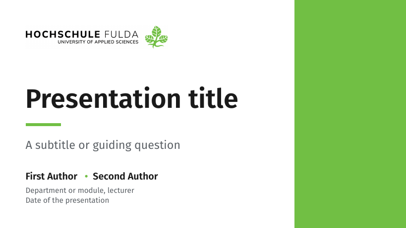
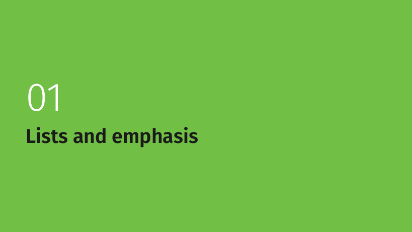
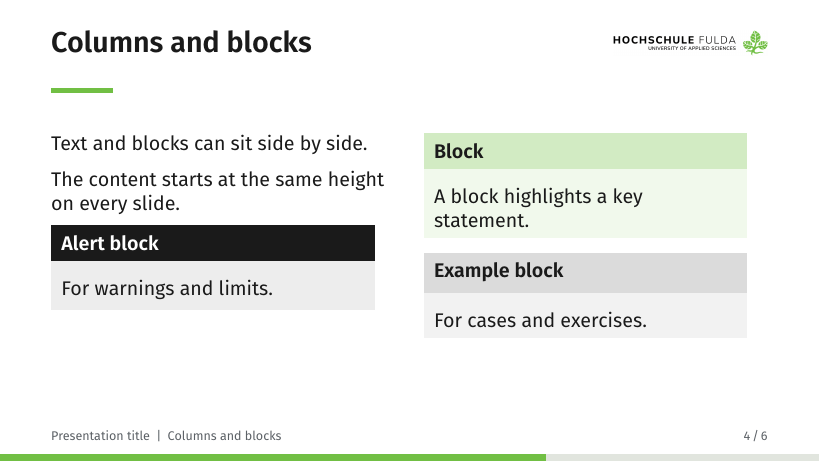
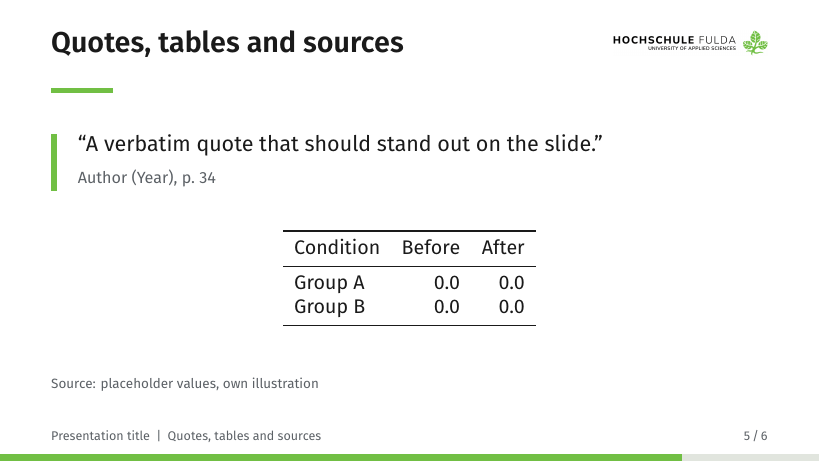

# Hochschule Fulda beamer theme (unofficial)

A LaTeX beamer theme for presentations at Hochschule Fulda: 16:9, Fira Sans, and the green of the university logo as accent colour.

> **Unofficial.** This theme is a student project. It is not affiliated with or endorsed by Hochschule Fulda and does not implement the university's corporate design.

| | |
|---|---|
|  |  |
|  |  |

## What you get

- Title slide, green section slides and a numbered agenda
- Footer with title, current section, slide number and a progress bar
- Styled lists, blocks and bibliography
- `\sourceline` and `\pullquote` for sources and quotes
- The university logo on the title slide and on every content slide

## Requirements

- **LuaLaTeX.** pdfLaTeX does not work.
- The packages `beamer`, `pgf`, `fontspec`, `unicode-math`, `fira` and `firamath`.
  A full TeX Live or MacTeX has all of them. On a smaller installation run `tlmgr install fira firamath`.

Tested with TeX Live 2025 and 2026.

## Quick start

1. Copy `beamerthemefulda.sty` and `hs-fulda-logo.png` next to your `.tex` file, or start from `example.tex`.
2. Load the theme:

   ```latex
   \documentclass[aspectratio=169, 11pt]{beamer}
   \usetheme{fulda}

   \title{Presentation title}
   \author{First Author \and Second Author}
   \date{1 January 2027}

   \begin{document}
   \begin{frame}[plain]
     \titlepage
   \end{frame}
   \end{document}
   ```

3. Compile with `latexmk -lualatex slides.tex`.

To build the example deck, run `make`. The result is `build/example.pdf`.
If you use Nix, `nix develop` gives you a shell with everything installed.

## Options and commands

| | |
|---|---|
| `\usetheme{fulda}` | uses `hs-fulda-logo.png` from the folder of your slides |
| `\usetheme[logo=<file>]{fulda}` | uses another image, given with its file extension |
| `\usetheme[nologo]{fulda}` | no logo |
| `\sourceline{<source>}` | small grey source line at the bottom of the slide |
| `\pullquote[<source>]{<text>}` | highlighted quote with a green bar |
| `\AtBeginSection{}` | turns the green section slides off |

The colours `fuldagreen`, `fuldadarkgreen` and `fuldagray` are available in your slides.
`fuldagreen` is too light for text on white; use `fuldadarkgreen` there.

Slide titles longer than about 35 characters wrap to two lines next to the logo.

## German decks

Pass `ngerman` to the class and load babel:

```latex
\documentclass[aspectratio=169, 11pt, ngerman]{beamer}
\usepackage[ngerman]{babel}
\usetheme{fulda}
```

The source line then reads „Quelle: …“. `\quelle` and `\zitat` are aliases for `\sourceline` and `\pullquote`.

## Licence

The theme and the example deck are released under the [MIT licence](LICENSE).

**The logo is not.** `hs-fulda-logo.png` and the name Hochschule Fulda belong to the university and are excluded from the MIT licence. The file is included so that decks for the university work out of the box. Use it only for work connected to Hochschule Fulda, and follow the university's rules for its logo.

Fira Sans, Fira Mono and Fira Math are not part of this repository. They ship with TeX Live under the SIL Open Font License.
